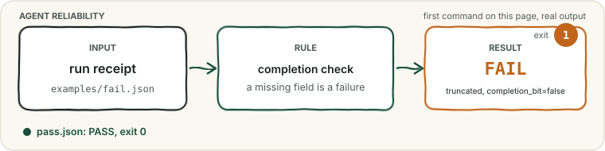

# homi-gate

**CI stays green when an agent run was cut off, a handoff carried null context, or MCP exposed every tool, because no test reads the run's own records.**

[](https://m8ven.ai/mcp/homayoun-safarpour/homi-gate?s=readme)
[](https://github.com/homayoun-safarpour/homi-gate/actions/workflows/ci.yml)
[](https://www.python.org/downloads/)
[](LICENSE)

Agent reliability: fail-closed CI checks for truncated agent runs, null handoffs, and open MCP tools.

homi-gate, written by Homayoun Safarpour, is a set of eight command-line checks that read what an AI agent run leaves behind: its final receipt, its handoff, its MCP tool settings and its tool calls. We built it because unit tests check the code of an agent, whereas a run can stop halfway or pass empty context to the next agent while every test passes. Each check applies fixed rules with no model calls and treats a missing field or an unreadable file as a failure. It returns exit 0 on a pass and exit 1 with the reasons, so that a CI job can block the merge.

```bash
git clone https://github.com/homayoun-safarpour/homi-gate
cd homi-gate && pip install -e .
homi-gate check-completion examples/fail.json
```

```text
FAIL check-completion: examples/fail.json
  - truncated=true on final record
  - completion_bit=false
  - status='truncated' is incomplete
```

That command exits 1. The same check on `examples/pass.json` prints `PASS check-completion: examples/pass.json` and exits 0.



[How it works](#how-it-works) · [Results](#what-each-result-means) · [Limits](#limits) · [Cite](#citation) · Part of [a small open stack for checking AI agents and their judges](https://homayoun-safarpour.github.io)

## What each result means

| Result | Exit | Meaning |
|---|---|---|
| `PASS <check>: <file>` | 0 | The file meets every rule of that check. |
| `FAIL <check>: <file>` and one reason per line on stderr | 1 | A rule failed, or the file is missing, empty or unreadable. |
| `{"applied": true, "exit": 0}` | 0 | `check-prewrite` only: a rule allows the proposed call. |
| `{"applied": false, "exit": 1, "reason": "..."}` | 1 | `check-prewrite` only: a rule denies the call, or no rule covers it. |
| `usage: homi-gate ...` | 2 | Wrong arguments, such as `check-trajectory` without `--mode`. |

A `PASS` shows that the record has the shape the check requires. It does not show that the agent's answer was correct.

## Use this when

| Situation | Use homi-gate? |
| --- | --- |
| You want CI to fail when an agent's receipt shows a truncated run or a done claim without proof | Yes |
| You want to stop a handoff with null context, or an MCP config with no allowlist | Yes |
| You want declared rules to block a write before the tool runs | Yes, with `check-prewrite` or `run_guarded` |
| You want a language-model judge to grade an answer | No. Use [Promptfoo](https://www.promptfoo.dev/docs/integrations/ci-cd/) or [DeepEval](https://deepeval.com/docs/metrics-tool-correctness) |
| You want to compare a run's score with an approved baseline | No. Use [trace-gate](https://github.com/homayoun-safarpour/trace-gate) |

`pip install git+https://github.com/homayoun-safarpour/homi-gate` is the other way to install it.

## The problem

A run can stop mid-tool with `truncated: true` in its receipt, the next agent can receive `context: null`, and an MCP server can be enabled with every tool open. A unit test passes in all three cases, because it never opens the receipt, the handoff or the config. Each failure is a plain fact in a file, so a fixed rule can catch it.

## How it works

Each command reads one JSON, JSON list or JSONL file (the final record is graded) and prints `PASS` or `FAIL` with the reasons.

| Command | Passes when | Fails when |
|---|---|---|
| `check-completion` | the completion bit or a complete `status`, plus a proof or artifact path | `truncated` is anything but `false`, an incomplete or unknown status (even with the bit set), neither bit nor status, done without proof, or an earlier record truncated |
| `check-handoff` | `from_agent`, `to_agent`, `proved`, `pending`, `stop`, `forbidden` and `report` are set, and `pending` is one goal | `context` is null or empty, a field is missing, null or empty, or `pending` is not one goal string (a longer list, an object or a dump) |
| `check-mcp-allowlist` | an allowlist of named tools and a denylist (which may be empty) with no overlap, or `enabled: false` with named tools | a list is missing, the allowlist is empty or holds a wildcard such as `*`, `all` or `any`, a tool is in both, or the file is not valid YAML or JSON |
| `check-tools` | `tools_called` matches `expected_tools` by name and count (with `--exact-args`, by arguments too) | an unexpected tool, a missing tool, an expected tool called more often than listed, or an empty expected list |
| `check-spans` | a parent span with a tool span whose status is `ok`, `error` or `denied` (A1, A2) | spans are missing or empty, there is no tool span, a tool span has no parent span, or a tool span is malformed |
| `check-spans --two-zero` | two runs scored `correctness=0` are told apart as an early stall and a late malformed call (A3) | the two runs look the same, or one run shows both modes |
| `check-trajectory --mode` | `strict`: the expected calls in order. `subset`: no extra call. `superset`: no missing call | an extra, missing or reordered call for that mode, or a judge score with no trajectory |
| `check-prewrite` | a rule covers the proposed call and its `deny_if` (`eq`, `ne`, `unchanged`, `forbidden`) does not fire; a rule with `read_only: true` may cover a call without `deny_if` | no rules or an empty list, no covering rule (a `write: false` field in the proposal does not skip this), an unsupported condition, or a missing `state.` or `args.` path |
| `check-tool-result` | an MCP `CallToolResult` without `isError: true`, whose `structuredContent` is valid when an `outputSchema` is declared | `isError: true`, a non-boolean `isError`, or missing or invalid `structuredContent` |

A score or judge field in a trajectory or prewrite record is ignored, so a judge cannot turn a failing record into a pass. The three trajectory modes follow [LangChain AgentEvals](https://docs.langchain.com/oss/python/langchain/test/evals).

One more failing case, with its real output:

```bash
homi-gate check-handoff examples/handoff_bad.json
```

```text
FAIL check-handoff: examples/handoff_bad.json
  - proved is null
  - stop is empty string
  - context is null (pass compact proved/pending/stop instead)
  - pending must be one goal, got list len=3
```

It exits 1. This repository's [CI workflow](.github/workflows/ci.yml) runs the tests and then the checks on the pass and fail examples, where each failing case must exit non-zero.

| Module | What it does |
|---|---|
| `homi_gate.cli` | The eight checks and the `homi-gate` command line |
| `homi_gate.guard` | `run_guarded(payload, tools)` calls a tool only after the prewrite rules allow it, and raises `Denied` otherwise |

## Limits

- It is not a full evaluation framework or a language-model judge. It checks the shape of records and does not judge the meaning of a reply.
- It trusts what the record says. A receipt that names a proof path passes even when that file does not exist.
- Field names are fixed, so other receipt formats need a converter first.
- `check-mcp-allowlist` reads a config file. It does not connect to an MCP server.
- `check-prewrite` and `run_guarded` trust the rules in the payload, so the rules must come from you and not from the agent whose call is checked.
- `check-handoff` accepts an empty list for `proved` (nothing proved yet) and for `forbidden` (nothing forbidden).
- It needs Python 3.11 or later, with `jsonschema` and `PyYAML`. On Windows the printed paths use backslashes.
- The examples are synthetic and hold no secrets.

## Use it in CI

```yaml
- run: pip install -e ".[dev]"
- run: pytest -q
- run: |
    homi-gate check-completion path/to/receipt.json
    homi-gate check-handoff path/to/handoff.json
    homi-gate check-mcp-allowlist path/to/mcp.yaml
    homi-gate check-trajectory --mode strict path/to/trajectory.json
```

A second workflow in `.github/workflows/` is a stub for a language-model evaluation. It runs only by hand and exits 1 until a real runner is added, so a skipped judge never counts as a pass.

## Roadmap

- JSON Schema exports and optional SARIF output for pull request annotations.
- More receipt formats, such as Agents SDK and LangGraph slices.

## Citation

Use the "Cite this repository" button on GitHub, or:

```bibtex
@software{safarpour2026homigate,
  author  = {Homayoun Safarpour},
  title   = {homi-gate},
  version = {0.1.0},
  year    = {2026},
  url     = {https://github.com/homayoun-safarpour/homi-gate}
}
```

Author: Homayoun Safarpour. [LinkedIn](https://www.linkedin.com/in/homayoun-safarpour/)

## License

MIT. See [`LICENSE`](LICENSE).
